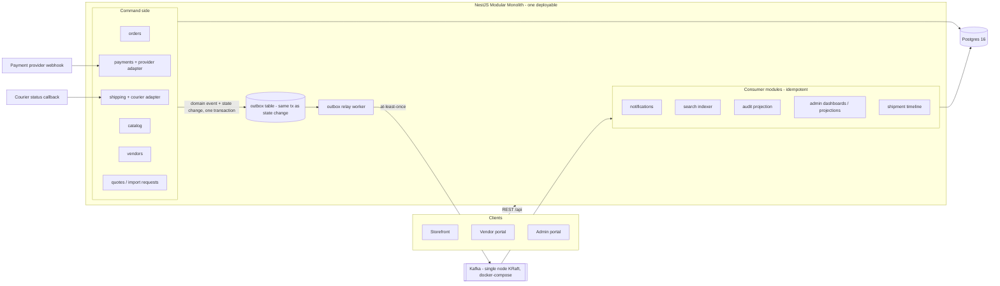

# Target Architecture — HB Platform

**Status:** Draft v0.1 — companion to [[ADR-001 Event-Driven Backbone|ADR-001]] and the [[BRS — Business Requirements|BRS]]
**Date:** 2026-07-07

## 1. Architecture principles (unchanged from day one)

1. **One modular monolith API.** Modules with ports are the seams; events are how
   modules talk without coupling. No microservices at this scale.
2. **`@hb/shared` is the only contract.** DTO interfaces, enums, and now event
   envelopes. API classes `implement` them; web consumes them directly.
3. **Money and the border are first-class data.** `numeric(12,2)` + currency column;
   origin/destination country pair; customs states in the shipment lifecycle.
4. **Correctness before infrastructure.** The outbox pattern (D1) is mandatory; the
   broker (D2) is swappable behind the `EVENT_BUS` port.

## 2. Current state (as-is)

```mermaid
flowchart LR
    subgraph clients [Clients]
        SF[Storefront - Angular SSR]
        VP[Vendor views]
        AP[Admin views]
    end
    subgraph api [NestJS Modular Monolith]
        AUTH[auth and users]
        CAT[products, categories, search]
        CART[cart]
        ORD[orders + state machine]
        PAY[payments - PAYMENT_PROVIDER stub]
        SHP[shipping - SHIPPING_PROVIDER stub]
        VEN[vendors]
        ADM[admin]
        AUD[audit]
        MAIL[mail]
    end
    PG[(Postgres 16)]
    clients -->|REST /api, @hb/shared DTOs| api
    api --> PG
```



Everything is synchronous. Cross-module effects (notify on order, index on product
change, audit on state change) are either direct service calls or missing.

## 3. Target state



Key properties:

- **Request path never touches the broker.** A checkout commits order + payment +
  outbox rows in one Postgres transaction and returns. Everything downstream is async.
- **Broker down ≠ platform down** (NFR-4). The relay retries; the outbox is the buffer.
- **Consumers are modules, not services.** Same process, same deploy, separate
  consumer groups — extraction to separate processes is possible later but not planned.

## 4. Event taxonomy

Envelope (defined in `libs/shared/src/events/`):

```ts
interface DomainEvent<T> {
  eventId: string;        // uuid — idempotency key
  type: string;           // e.g. 'orders.state.changed'
  aggregateId: string;    // partition key — per-aggregate ordering
  occurredAt: string;     // ISO 8601
  version: 1;             // additive-only evolution
  payload: T;
}
```

| Topic | Events | Producers | Consumers |
|---|---|---|---|
| `hb.orders` | `orders.placed`, `orders.state.changed`, `orders.cancelled` | orders | notifications, audit, dashboards, vendor fan-out |
| `hb.payments` | `payments.captured`, `payments.failed`, `payments.refunded` | payments (incl. webhook handler) | orders (confirm), notifications, audit, settlement projection |
| `hb.shipments` | `shipments.status.changed` (booked / in_transit / **at_border** / **customs_cleared** / out_for_delivery / delivered / failed) | shipping (incl. courier callbacks) | timeline, notifications, dashboards, audit |
| `hb.catalog` | `catalog.product.created/updated/archived` | products | search indexer, audit |
| `hb.vendors` | `vendors.status.changed` | vendors, admin | notifications, audit |
| `hb.quotes` | `quotes.requested`, `quotes.answered`, `quotes.accepted` | quotes | notifications, SLA tracker, audit |

Conventions:
- Topic = bounded context, event type = past-tense fact. Never commands.
- Partition key = `aggregateId` → all events for one order/shipment arrive in order.
- Payloads carry **snapshots of what changed**, not entity dumps; money always as
  `{ amount: string, currency: 'ZAR' | 'NAD' }`.
- Additive-only payload evolution; breaking change ⇒ new `version`, consumers handle both during migration.

## 5. Consistency & failure model

| Concern | Rule |
|---|---|
| Producing | Event row committed in the same transaction as the state change (outbox). |
| Delivery | At-least-once, relay → Kafka. Relay is a `@nestjs/schedule` worker with row-level locking (`FOR UPDATE SKIP LOCKED`). |
| Consuming | Idempotent: `processed_events(eventId, consumerGroup)` unique index; duplicate ⇒ ack and skip. |
| Poison messages | Per-group dead-letter topic after N retries; DLQ depth visible in admin (NFR-8). |
| Ordering | Guaranteed per aggregate (partition key), not globally. Nothing in the domain needs global ordering. |
| Read models | Dashboards/timeline are rebuildable projections — replay from the topic (or re-drain from `outbox` history) is the recovery story. |

## 6. Testing strategy (repo non-negotiables applied)

- Outbox write + state change tested at service level (same-transaction assertion) — money/order rules already require same-PR unit tests.
- Consumers unit-tested with fabricated envelopes; idempotency tested by double-delivery.
- CI uses the in-memory `EVENT_BUS` adapter — **no broker in CI**; the Kafka adapter gets one thin integration test run locally via compose.

## 7. What deliberately does not change

- Angular SSR storefront and its API consumption pattern.
- Auth model, ownership checks, DTO validation pipeline.
- TypeORM + migrations discipline; Postgres remains the single source of truth — Kafka is a *log of facts*, never the system of record.
- Deployment shape: API `dist` + web SSR server + Postgres (+ broker container).
